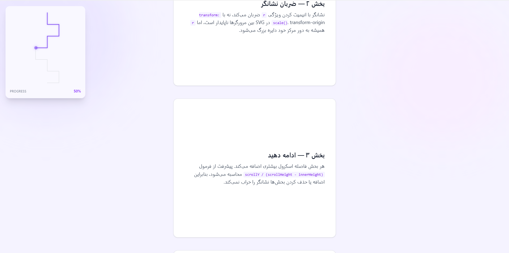

# Scroll Progress Indicator | SVG Path Fill on Scroll

A responsive scroll-driven progress indicator built with HTML, Tailwind CSS, and vanilla JavaScript. The project renders an SVG path that fills progressively as the user scrolls, with a pulsing marker that travels along the path using `getPointAtLength()` — no animation libraries required.

## Table of Contents

- [Demo](#demo)
- [Screenshots](#screenshots)
- [Tech Stack](#tech-stack)
- [Project Structure](#project-structure)
- [Author](#author)

## Demo

[Live Demo](https://ali-mirzaei-dev.github.io/JS-Tracepath/)

## Screenshots


| Desktop layout | Mobile layout |
|---|---|
|  |  |

## Tech Stack

| Technology | Purpose |
|---|---|
| HTML5 | Semantic markup and SVG path structure |
| Tailwind CSS | Responsive layout|
| Vanilla JavaScript | Scroll tracking|

## Project Structure

```text
Scroll-Progress/
│
├── assets/
│   ├── Font/
│   ├── Images/
│   │
│   ├── JavaScript/
│   │   └── main.js
│   │
│   └── StyleSheet/
│       ├── master.css
│       └── output.css
│
└── index.html
```

## Author

**Ali Mirzaei** – Frontend Developer

- [GitHub](https://github.com/ali-mirzaei-dev)
- [LinkedIn](https://www.linkedin.com/in/ali-mirzaei-dev/)
- [Instagram](https://instagram.com/ali.mirzaei.dev)
- [Email](mailto:ali.mirzaei.kt@gmail.com)